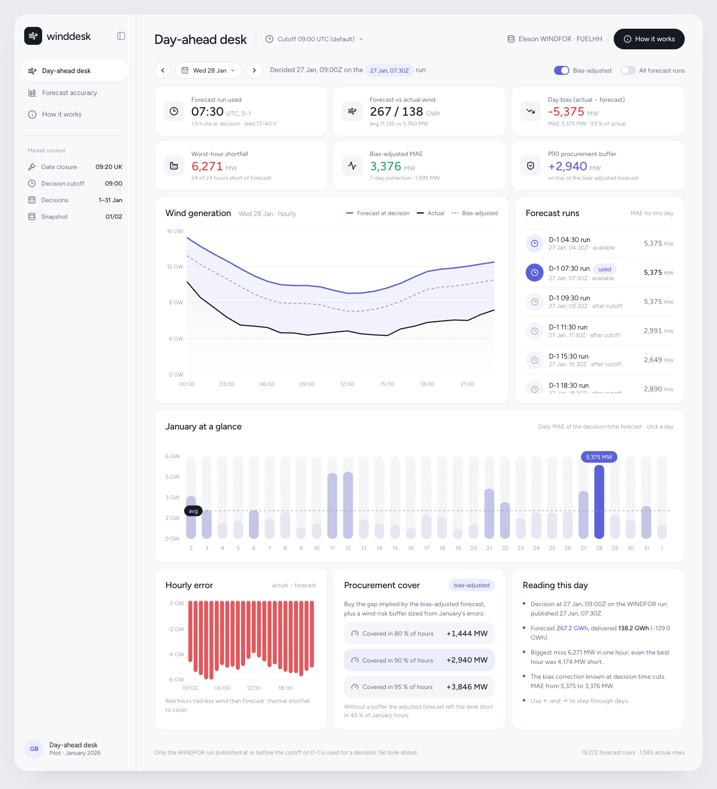
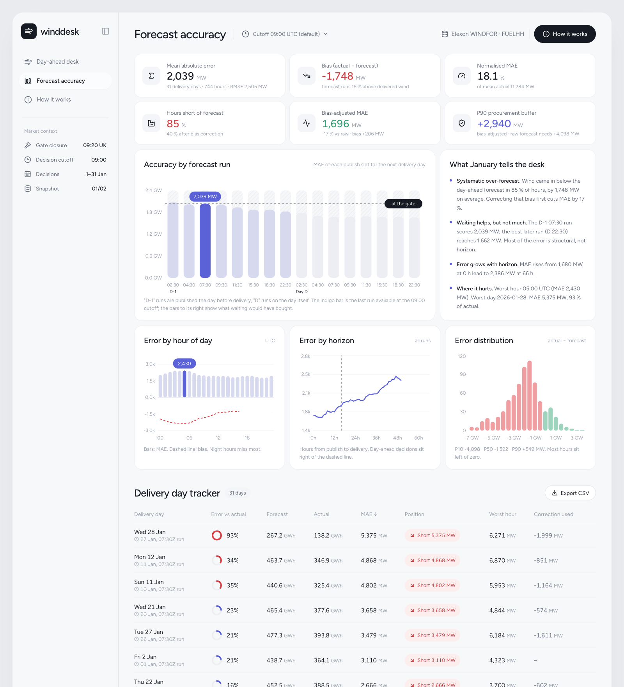

# WindDesk — day-ahead wind forecast desk (GB, January 2026)

A small web app for a UK supplier's day-ahead procurement team. It answers two questions the desk has at 09:00 on D-1, just before the day-ahead auction closes:

1. **What is the latest wind forecast I can act on right now?** — the point-in-time Elexon WINDFOR vintage, never a later one.
2. **How wrong is it, in MW?** — so the thermal purchase can carry a quantified wind-risk buffer.

Live app: **<VERCEL_OR_VPS_URL>** · Demo video: **<YOUTUBE_UNLISTED_URL>**





## What it does

| Page | For | Shows |
|---|---|---|
| **Day-ahead desk** | the trader | January-at-a-glance strip, the forecast vintage used (and how old it was), forecast vs actual per hour, every later vintage ("what you'd have known had you waited"), a leak-free bias-adjusted forecast, hourly shortfall bars, and the recommended P80/P90/P95 procurement buffer |
| **Forecast accuracy** | the trader + analyst | MAE / RMSE / bias / nMAE, hours-short share, error by hour of day, accuracy by publish vintage (what waiting buys), error vs forecast horizon (0–72 h, all vintages), error distribution with percentiles, per-day table with CSV export, auto-written findings |
| **How it works** (dialog) | everyone | the methodology in five short paragraphs |

The **decision cutoff** selector (header) re-runs everything for a different D-1 cutoff time, e.g. the 09:20 gate itself, or 23:00 to see an "if we traded intraday" view.

## Methodology (the part that matters)

* **Window.** "Decisions made in January 2026" ⇒ decision dates 1–31 Jan ⇒ **delivery days 2 Jan – 1 Feb 2026**. The snapshot holds WINDFOR vintages published 31 Dec – 1 Feb and FUELHH actuals over the same span.
* **Point-in-time selection.** WINDFOR is republished ~8× a day (02:30, 04:30, 07:30, 09:30, 11:30, 15:30, 18:30, 22:30 UTC) with a ~73-hour horizon. For delivery day D the desk uses the vintage with the greatest `publishTime ≤ D-1 cutoff` (default 09:00 → the 07:30 publish; the GB day-ahead auction closes 09:20 UK). This is implemented with a bisect over sorted publish times in [`backend/core.py`](backend/core.py) (`as_of`). Later vintages are only ever shown as context.
* **Grain.** WINDFOR is hourly, FUELHH is half-hourly. Actuals are averaged to the hour (mean of the :00 and :30 settlement periods). January: UK time == UTC, so no DST handling is needed; all times are UTC.
* **Error convention.** `error = actual − forecast`; `shortfall = forecast − actual`. Negative error = less wind than promised = the desk is short and must cover from thermal.
* **Metrics.** MAE, RMSE, bias, nMAE (MAE / mean actual; MAPE is avoided because wind can approach zero), shortfall percentiles (P80/P90/P95 = buffer sizes), hours-short share, breakdowns by hour of day, by publish vintage, and by forecast horizon (pooling all vintages removes the hour-of-day confound a single daily vintage would have).
* **Bias correction.** WINDFOR runs ~15 % above metered wind in January (curtailment and the forecast's wider scope are the usual causes). The desk applies the mean error of the 7 delivery days ending at **D-2** — all fully known at D-1 09:00 — so the correction is leak-free. It cuts MAE by ~17 % and halves the P80 buffer. The first days of the window have a shorter history and a noisier correction; the desk says so.

Headline January findings (09:00 cutoff): MAE 2,039 MW (18 % of mean actual), bias −1,748 MW, actual below forecast in 85 % of hours, P90 buffer +4,098 MW raw / +2,940 MW bias-adjusted, worst day 28 Jan (forecast 267 GWh, delivered 138 GWh).

## Repository layout

```
.
├── api/index.py              Vercel serverless entry (re-exports the FastAPI app)
├── backend/
│   ├── app.py                FastAPI routes: /api/meta, /api/dayahead/{date}, /api/accuracy, /api/health
│   ├── core.py               domain logic: loading, as-of selection, hourly aggregation, metrics, bias correction
│   ├── ingest.py             one-shot Elexon fetch → data/*.json (re-run to refresh the snapshot)
│   ├── data/                 windfor.json, fuelhh.json — January 2026 snapshot (committed, ~1.3 MB)
│   ├── tests/test_core.py    pytest: as-of boundary cases, no-lookahead, metrics signs, rolling-bias leak test, snapshot smoke test
│   ├── Dockerfile            python:3.12-slim + uvicorn
│   └── requirements.txt
├── frontend/                 Vite + React 19 + TypeScript + Tailwind v4 + Recharts + TanStack Query; lucide-react icons; clean white dashboard theme with one indigo accent (Figtree)
│   ├── src/App.tsx           header, cutoff selector, tabs, "How it works" dialog
│   ├── src/DayAhead.tsx      day-ahead desk page
│   ├── src/Accuracy.tsx      accuracy page
│   ├── src/api.ts            typed API client + React Query hooks
│   ├── src/ui.tsx            KPI tiles, cards, rings, chart helpers (bar pills, hatch, tooltips), CSV export
│   ├── Dockerfile            node build → nginx (serves SPA, proxies /api → backend)
│   └── nginx.conf
├── docker-compose.yml        backend :8000 + frontend :3000
├── vercel.json               static frontend + Python serverless /api on Vercel
├── .github/workflows/ci.yml  ruff + pytest, lint + build, docker build
├── PLAN.md                   the plan this was built from
└── VIDEO_SCRIPT.md           demo script for the two-part video
```

## Run it

**Docker (recommended, one command):**
```bash
docker compose up --build
```
Open http://localhost:3000. API docs at http://localhost:8000/docs.

**Dev mode:**
```bash
python -m venv .venv && .venv/bin/pip install -r backend/requirements.txt
.venv/bin/uvicorn backend.app:app --reload --port 8000
cd frontend && npm ci && npm run dev        # http://localhost:5173, proxies /api to :8000
```

**Tests & lint:**
```bash
.venv/bin/pytest -q && .venv/bin/ruff check backend api
cd frontend && npm run lint && npm run build
```

**Refresh the data snapshot** (not needed to run; the January snapshot is committed):
```bash
.venv/bin/python backend/ingest.py
```

## Deploy

* **Vercel:** import the repo; `vercel.json` builds `frontend/dist` and serves `api/index.py` as a Python function with `backend/**` bundled. No env vars.
* **VPS:** `docker compose up -d --build`, then put Caddy/nginx with TLS in front of port 3000.

## API

| Route | Returns |
|---|---|
| `GET /api/meta` | decision window, delivery days, default cutoff, snapshot info |
| `GET /api/dayahead/{YYYY-MM-DD}?cutoff=HH:MM` | hourly rows (forecast, actual, error, adjusted, lead), vintage used, totals, metrics, every vintage for the evolution chart |
| `GET /api/accuracy?cutoff=HH:MM` | overall + bias-adjusted metrics, percentiles, buffers, by hour / vintage / horizon, histogram, per-day table |

## Design notes for reviewers

* **No database, no pandas.** The brief fixes the window to January 2026, so the data is a ~20k-row snapshot fetched once and committed. Pure-Python `statistics`/`bisect` keep the serverless bundle small and cold starts fast. Swap in Parquet/DuckDB when the window grows beyond a few months.
* **All domain logic is pure functions** in `core.py`; FastAPI is a thin layer. The tests pin the behaviours that matter: cutoff boundary is inclusive, later vintages never leak, the rolling bias ignores D-1.
* **Frontend state is URL-free and server-derived**: React Query caches by `(date, cutoff)`; `placeholderData` keeps the previous day on screen while the next loads. Keyboard ← / → steps through days.
* **Deliberate simplifications** are marked with `ponytail:` comments in the code.

## Limitations / next steps

* Wind only, national level, one month — exactly the brief. No prices, demand, solar, or regional split.
* The bias correction is a simple rolling mean; a regression on forecast level and hour of day would do better.
* No live polling of Elexon; `ingest.py` is a manual refresh. Add a scheduled job and a date-range picker when the client wants more than January.

## AI tools disclosure

This project was built with the help of **Claude (Anthropic)** via Claude Code: data exploration against the Elexon API, planning, code generation for both backend and frontend, tests, and this README. All domain decisions (window definition, point-in-time selection, error conventions, bias-correction design) and the final review were made by the author.
